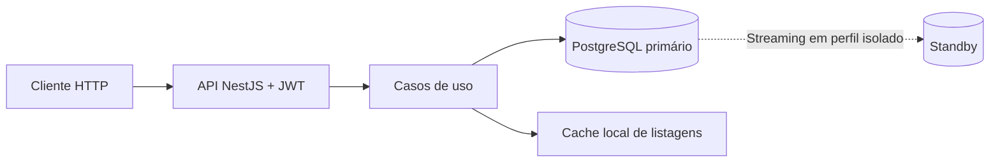

# naPorta — API de pedidos

API REST para gerenciar pedidos, desenvolvida em Node.js 24, NestJS 11, TypeScript, PostgreSQL 18 e Prisma ORM 7. Inclui autenticação JWT, criação e edição de pedidos, filtros, paginação e exclusão lógica. A entrega contempla somente o backend.

## Funcionalidades e rotas

Pedidos reúnem cliente, endereço de entrega, itens, previsão de entrega e status. A listagem permite filtrar por número, período de previsão e status, com até 100 registros por página.

| Método | Rota | Função |
| --- | --- | --- |
| POST | `/api/v1/auth/login` | Autenticar e obter token JWT |
| POST | `/api/v1/orders` | Criar pedido |
| GET | `/api/v1/orders` | Listar com filtros e paginação |
| GET | `/api/v1/orders/:id` | Consultar por UUID público |
| PATCH | `/api/v1/orders/:id` | Atualizar campos e status |
| DELETE | `/api/v1/orders/:id` | Excluir logicamente |
| GET | `/health/ready` | Verificar conexão com o banco: 200 ou 503 |

Todas as rotas de pedidos exigem `Authorization: Bearer <token>`. Respostas JSON de sucesso usam `code`, `message`, `data` e `requestId`; DELETE retorna 204 sem corpo. Contratos, exemplos de payload e erros estão em [API](docs/05-api.md); status e transições, em [regras de negócio](docs/03-regras-de-negocio.md).

## Arquitetura



O backend é organizado por funcionalidade. Controllers adaptam o HTTP, casos de uso concentram regras e interfaces isolam persistência, cache e autenticação. Prisma acessa o banco com pool de até dez conexões por processo. O schema é único em `database/`; migrations SQL são aplicadas pelo executor nativo do projeto.

O modelo relacional separa pedidos, snapshots de cliente e endereço, itens e usuários. IDs inteiros ficam na persistência; a API expõe UUIDs. Valores monetários usam decimal no banco e strings na API. A exclusão lógica preserva os registros.

Listagens usam cache assíncrono em arquivos, com TTL de 60 segundos e versão verificada no primário. Alterações de pedidos invalidam essa versão na mesma transação. Leituras simultâneas equivalentes compartilham a consulta; falhas do cache permitem continuar pelo banco. Redis não é dependência.

Todas as leituras e escritas da API usam o primário. A replicação PostgreSQL funciona em perfil Compose isolado, sem consultas HTTP ao standby. Há configuração de Nginx com HTTPS e múltiplas instâncias no Swarm, mantendo banco único; deploy público e failover automático não estão validados.

Detalhes em [arquitetura e dados](docs/04-arquitetura-e-dados.md), [infraestrutura](docs/16-infraestrutura-e-acessos.md) e [replicação](docs/17-replicacao.md).

## Segurança

- Senhas protegidas com Argon2id; JWT valida assinatura, emissor, audiência e expiração. A duração padrão é de 15 minutos, sem refresh token ou revogação imediata.
- Login bloqueia o par e-mail/IP por 15 minutos após cinco credenciais inválidas, com contadores compartilhados no PostgreSQL.
- Validação estrita rejeita campos desconhecidos e entradas inválidas. Erros internos são sanitizados; logs e métricas não incluem senhas, tokens ou payloads.
- CORS aceita origens explícitas; respostas autenticadas usam `Cache-Control: no-store`. Segredos vêm do ambiente privado.
- Banco tem permissões separadas para aplicação e migrations. Cache usa limites de tamanho, permissões restritas e nomes derivados por hash.

Usuários autenticados acessam um conjunto compartilhado de pedidos; não há multitenancy, cadastro público ou papéis administrativos. UUID não substitui controle de acesso. A configuração HTTPS pertence ao proxy. As verificações automatizadas de dependências, segredos, código e imagens estão descritas em [segurança](docs/09-ci-e-seguranca.md).

## Execução local

Você precisa de Git, Make, Bash, Python 3, Docker e Docker Compose v2, com o Docker iniciado. O build de Node.js e as ferramentas PostgreSQL rodam nos containers neste roteiro; não é necessário instalar Node ou PostgreSQL no host.

**1. Obtenha o código e entre na raiz:**

```sh
git clone https://github.com/portifolio-vinicius/api-na-porta.git
cd api-na-porta
docker info >/dev/null
docker compose version
```

Se já tem o repositório, use sua pasta atual. Execute os próximos blocos no mesmo terminal.

**2. Configure um ambiente local com credenciais geradas na sua máquina:**

```sh
export ENV=local
export PGHOST=127.0.0.1 PGPORT=5432 DB_PORT=5432
export PGUSER=postgres PGDATABASE=naporta_local
export DB_CONTAINER=naporta-naporta-local-db
export API_HOST_PORT=3000

export PGPASSWORD="$(python3 -c 'import secrets; print(secrets.token_hex(24))')"
export APP_PASSWORD="$(python3 -c 'import secrets; print(secrets.token_hex(24))')"
export MIGRATOR_PASSWORD="$(python3 -c 'import secrets; print(secrets.token_hex(24))')"
export JWT_SECRET="$(python3 -c 'import secrets; print(secrets.token_hex(32))')"
export JWT_ISSUER=naporta-local JWT_AUDIENCE=naporta-api
export DEMO_USER_EMAIL=demo@example.test
export DEMO_USER_PASSWORD="$(python3 -c 'import secrets; print(secrets.token_hex(16))')"

export API_DATABASE_URL="postgresql://naporta_app:${APP_PASSWORD}@db:5432/${PGDATABASE}"
export MIGRATOR_API_URL="postgresql://naporta_migrator:${MIGRATOR_PASSWORD}@db:5432/${PGDATABASE}"
```

Guarde os valores em um local privado se precisar retomar em outro terminal; não os adicione ao Git. Em volumes já existentes, reutilize as credenciais originais em vez de gerar novas. As URLs usam `db:5432`, endereço interno do Compose. `DB_CONTAINER` faz as operações SQL usarem o cliente PostgreSQL do container.

**3. Suba a aplicação e confira a prontidão:**

```sh
make up
curl --fail-with-body "http://127.0.0.1:${API_HOST_PORT}/health/ready"
```

O comando prepara o banco, aplica migrations, cria seis pedidos/onze itens fictícios e o usuário de demonstração, constrói a API e aguarda sua prontidão. A primeira execução pode demorar pelo download das imagens e dependências. A API fica em `http://127.0.0.1:3000/api/v1`; a prontidão deve retornar HTTP 200.

**4. Faça login e consulte pedidos:**

```sh
TOKEN="$(python3 - <<'PYLOGIN'
import json
import os
import urllib.request

url = 'http://127.0.0.1:' + os.environ['API_HOST_PORT'] + '/api/v1/auth/login'
payload = json.dumps({
    'email': os.environ['DEMO_USER_EMAIL'],
    'password': os.environ['DEMO_USER_PASSWORD'],
}).encode()
request = urllib.request.Request(url, data=payload, headers={'Content-Type': 'application/json'})
with urllib.request.urlopen(request) as response:
    print(json.load(response)['data']['accessToken'])
PYLOGIN
)"
curl --fail-with-body "http://127.0.0.1:${API_HOST_PORT}/api/v1/orders?page=1&pageSize=20" \
  -H "Authorization: Bearer ${TOKEN}"
unset TOKEN
```

O login usa as credenciais configuradas no passo 2 e extrai o token de `data.accessToken`. Exemplos de criação, atualização, filtros e erros estão no [contrato da API](docs/05-api.md).

**Logs e encerramento:**

```sh
make logs SERVICE=api
# Ctrl+C encerra o acompanhamento dos logs.
make down
```

`make down` preserva banco e cache. Para subir novamente, reutilize as mesmas variáveis e execute `make up`. Se a porta 3000 estiver ocupada, altere `API_HOST_PORT`; para a porta do banco, ajuste `DB_PORT` e `PGPORT` juntos. Em falha de inicialização, consulte `make logs SERVICE=api` ou `make logs SERVICE=db`.

Configuração completa e comandos: [scripts e ambiente](docs/07-scripts-e-ambiente.md#ambiente-do-usuário-e-segredos). Permissões, migrations e volumes: [operações PostgreSQL](docs/15-postgresql-operacoes.md). Pré-requisitos dos comandos de validação: [esteiras executáveis](docs/13-esteiras-executaveis.md).

Para compilar e verificar a qualidade, use `make check`. `make integration METRICS_DIR=artifacts/performance/<execucao-nova>` executa integração com PostgreSQL, réplica, seed, HTTP e ciclo Compose; `make routeReport` agrega as métricas do mesmo diretório. Operações de backup, restauração e rollback estão em [operações PostgreSQL](docs/15-postgresql-operacoes.md).

## Desempenho e limites

Há coleta de latência no servidor e no cliente, status HTTP, cache e bytes por rota. Os resultados abaixo são históricos de 18/10/2026, com ambientes distintos; não representam SLA nem uma nova medição desta revisão.

| Ensaio | Resultado registrado |
| --- | --- |
| Volume: 100 mil pedidos, duas APIs, 10 clientes simultâneos | 282,62 requisições/s; p95 de 117,96 ms |
| Mesmo ensaio, 100 clientes simultâneos | 275,31 requisições/s; p95 de 1.003,70 ms |
| Otimização de listagem: uma API, 25 clientes e alterações concorrentes | p95 de 499,33 ms antes e 34,11 ms depois, em janela de 8 s |

O ensaio de volume registrou 17.854 requisições e zero erros. A otimização posterior adicionou índices de pedidos ativos, compartilhamento de consultas e menor custo de manutenção do cache. Consulte condições, commits e limitações na [análise de volume](docs/performance/latencia-016.md) e na [medição da otimização](docs/performance/latencia-017.md).

O pool permite até dez conexões PostgreSQL por processo, com timeout de conexão de cinco segundos. Clientes HTTP simultâneos não equivalem a conexões abertas no banco. Não há coleta de ocupação ou espera no pool; contagens exatas e páginas profundas continuam sendo pontos de atenção. Capacidade produtiva, lag aceitável e recuperação de falhas ainda exigem dimensionamento.

## Histórico e decisões

| Etapa | Decisão e motivo |
| --- | --- |
| Escopo inicial | Entregar somente a API de pedidos; frontend, pagamentos, estoque e Serverless ficaram fora do escopo. |
| Base técnica | NestJS, PostgreSQL e Prisma para o domínio relacional; TypeScript estrito e organização por funcionalidade para separar contratos e responsabilidades. |
| Modelagem | IDs internos inteiros e UUIDs públicos; snapshots de cliente/endereço preservam os dados de cada pedido, e exclusão lógica mantém o histórico. |
| Autenticação e contratos | JWT, Argon2id, validação estrita e envelopes JSON centralizados para uniformizar consumo e tratamento de erros. |
| Cache e consistência | Cache local substituível por interface, sem Redis; versionamento transacional preserva a invalidação entre instâncias. Consultas permanecem no primário para enxergar escritas recentes. |
| Operação | Compose para execução reproduzível, migrations SQL com executor único e réplica isolada para validar propagação sem prometer failover. |
| Medição e otimização | Primeiro medir consultas e concorrência; depois adicionar índices e reduzir consultas repetidas e varreduras do cache. A contagem exata foi preservada. |

As decisões e evidências completas permanecem em [escopo e premissas](docs/01-escopo-e-premissas.md), [arquitetura](docs/04-arquitetura-e-dados.md) e [registros de tarefas](docs/tasks). O [índice da documentação](docs/README.md) reúne as demais referências técnicas.

## Onde encontrar mais detalhes

| Assunto | Referência |
| --- | --- |
| Escopo e requisitos | [Premissas e decisões](docs/01-escopo-e-premissas.md) · [Requisitos](docs/02-requisitos.md) |
| Pedidos, status e transições | [Regras de negócio](docs/03-regras-de-negocio.md) |
| Rotas, JSON, JWT e erros | [Contrato da API](docs/05-api.md) |
| Camadas, modelo de dados e cache | [Arquitetura e dados](docs/04-arquitetura-e-dados.md) |
| Variáveis, subida e seed | [Scripts e ambiente](docs/07-scripts-e-ambiente.md) |
| Segurança e verificações automatizadas | [CI e segurança](docs/09-ci-e-seguranca.md) |
| Integração e estado das validações | [Validação](docs/08-validacao.md) · [Estado executável](docs/13-esteiras-executaveis.md) |
| Coleta de métricas e resultados | [Performance das rotas](docs/11-performance-das-rotas.md) · [Inventário](docs/performance/rotas.md) |
| Migrations, backup, restauração e rollback | [Operações PostgreSQL](docs/15-postgresql-operacoes.md) |
| HTTPS, múltiplas instâncias e réplica | [Infraestrutura](docs/16-infraestrutura-e-acessos.md) · [Replicação](docs/17-replicacao.md) |
| Histórico detalhado | [Registros de tarefas](docs/tasks) · [Índice completo](docs/README.md) |
