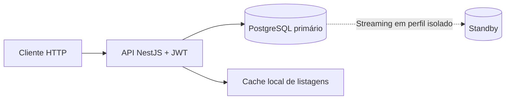

# naPorta — desafio e esteiras

Web API de pedidos em NestJS, PostgreSQL e Prisma: autenticação JWT, CRUD, filtros, paginação, exclusão lógica e cache de listagens em arquivos. O frontend não faz parte da entrega atual.

**Implementado:** API, integração HTTP real, métricas por rota, ambiente Compose e replicação PostgreSQL em perfil isolado. Swarm/Nginx têm configuração e scripts; deploy público, failover automático e SLA de produção não estão validados. Veja [estado executável e gates](docs/13-esteiras-executaveis.md).



Todas as leituras e escritas HTTP usam o primário. O standby não recebe consultas da API. No perfil Swarm, Nginx distribui requisições entre instâncias da API; o banco permanece único. [Arquitetura](docs/04-arquitetura-e-dados.md) e [infraestrutura](docs/16-infraestrutura-e-acessos.md).

O [repositório público](https://github.com/portifolio-vinicius/api-na-porta) usa PRs para `develop` e promoção por PR para `master`. As proteções registradas e suas evidências estão nos [documentos 09](docs/09-ci-e-seguranca.md) e [14](docs/14-publicacao-e-protecao.md).

## Organização

- `backend/`: API NestJS; instruções em [backend/AGENTS.md](backend/AGENTS.md).
- `database/`: migrations SQL, seed e operações PostgreSQL; instruções em [database/AGENTS.md](database/AGENTS.md).
- `docs/`: requisitos e decisões; índice em [docs/README.md](docs/README.md).
- [AGENTS.md](AGENTS.md): instruções gerais e coordenação do trabalho.

Os três arquivos `AGENTS.md` são complementares. As regras comuns ficam na raiz e as regras específicas ficam somente no respectivo componente.

## Tecnologias

Backend em Node.js 24, NestJS 11, PostgreSQL 18 e Prisma ORM 7 com adapter `pg`. O lockfile fixa as dependências. Organização por feature folders, tipos/interfaces e IDs integer internos/UUIDs públicos estão definidos em [arquitetura](docs/04-arquitetura-e-dados.md), incluindo replicação e escalabilidade.

## Execução

Para compilar: `make check`. Para executar o ambiente completo, configure as variáveis listadas em `make help` e rode `make up` (`ENV=local|demo`, conexões PostgreSQL para host e Compose, JWT e usuário fictício). Migrations e seed completo de seis pedidos/onze itens rodam antes da API; `make down` preserva volumes e `make logs SERVICE=api` acompanha a aplicação. `/health/ready` responde 200 somente quando o banco responde, caso contrário 503. Login: `POST /api/v1/auth/login`. Pedidos: `POST`, `GET` (lista e detalhe), `PATCH` e `DELETE` em `/api/v1/orders`, com JWT Bearer; a exclusão é lógica. Listagens usam cache local de arquivos. `make dbUp` prepara apenas PostgreSQL. A imagem pode ser construída com `docker build -f backend/Dockerfile -t naporta-backend:local .`. A suíte HTTP coleta latência, status e bytes reais por rota. `CACHE_DRIVER=disabled` desativa cache e `CORS_ORIGINS` lista origens permitidas.


Para validar documentação, execute `make docsCheck`; para operações reais do banco, `make dbIntegration`. Configuração do banco em [operações PostgreSQL](docs/15-postgresql-operacoes.md). `make integration METRICS_DIR=artifacts/performance/<execucao-nova>` executa operações PostgreSQL, streaming, HTTP e ciclo Compose; `make routeReport` valida e agrega a mesma execução. Veja [o catálogo de comandos](docs/07-scripts-e-ambiente.md).

Orientações da [esteira eficiente](docs/10-eficiencia-e-documentacao.md) e da [performance por rota](docs/11-performance-das-rotas.md), com [inventário de rotas](docs/performance/rotas.md). Scripts e workflow de CI existem; a coleta HTTP acompanha a mesma integração, sem suíte separada de carga.

## Tempos, concorrência e conexões da API

Resultados históricos de 18/10/2026, registrados na [análise de latência da tarefa 016](docs/performance/latencia-016.md), a partir do ensaio da tarefa 014 no commit `eaeb1d7b00d0e60dd69a38fa57f2a15519159f4f`. Não são uma nova medição desta revisão nem garantia de capacidade da versão atual.

| Clientes HTTP simultâneos | Requisições/s efetivas | p95 cliente (ms) | p99 cliente (ms) |
| --- | --- | --- | --- |
| 1 | 108,93 | 35,02 | 46,30 |
| 10 | 282,62 | 117,96 | 183,56 |
| 25 | 266,03 | 274,65 | 401,67 |
| 50 | 249,01 | 516,68 | 739,96 |
| 100 | 275,31 | 1.003,70 | 1.511,82 |

Ensaio com 100.000 pedidos/240.000 itens, duas APIs (1 CPU/512 MiB cada), PostgreSQL (2 CPUs/1 GiB), cache de arquivos e cerca de 70% leituras/30% escritas. Cada etapa teve 3 s de aquecimento e 15 s medidos, em modelo fechado de concorrência constante. Foram 17.854 requisições medidas, zero erros e correlação completa das respostas HTTP concluídas com métricas do servidor. Os percentis agregam cenários distintos; consulte a análise para tempos por operação. Não houve Nginx, HTTPS ou leituras em réplica nesse ensaio. O comando opcional `make apiVolume` da tarefa 014 ainda não integra esta base.

A [medição seguinte da listagem](docs/performance/latencia-017.md) aplica os índices de ordenação e o cache ajustado. Ela usa um banco de 2 GiB, uma API no host e janelas mais curtas. Com 25 clientes e invalidação da versão a cada 40 ms, o p50 do cliente foi 11,7 ms nessa execução. Esse número não substitui a tabela histórica acima nem é um SLA.

Concorrência HTTP é a quantidade de clientes simultâneos do ensaio; não informa quantas conexões PostgreSQL estavam abertas. Os limites abaixo são configuração, sem medição de ocupação do pool:

| Configuração implementada | Valor |
| --- | --- |
| Pool PostgreSQL por processo de API | Até 10 conexões |
| Duas instâncias de API | Até 20 conexões somadas |
| Timeout para conexão ao PostgreSQL | 5 s |
| Conexão ociosa no pool | 10 s |
| `statement_timeout` / `lock_timeout` | 10 s / 5 s |
| Sessão ociosa em transação | 10 s |
| HTTP `requestTimeout` / `headersTimeout` | 15 s / 10 s |

Fontes: [adapter PostgreSQL](backend/src/shared/database/prismaService.ts) e [bootstrap HTTP](backend/src/main.ts). Timeouts HTTP de recebimento não representam um SLA de execução da rota. O orçamento Swarm, incluindo rolling update e roles do banco, está no [documento 16](docs/16-infraestrutura-e-acessos.md).

A integração obrigatória registra tempo no servidor e no cliente, status HTTP, cache e bytes de corpo por rota. `p95` é o valor no posto `ceil(0,95 × N)` das amostras ordenadas; grupos com menos de 100 amostras são sinalizados como descritivos. Não há coleta implementada de conexões ativas/ociosas, espera no pool ou conexões TCP HTTP.

```sh
# Execute na raiz, com Docker ativo e pré-requisitos configurados.
# Escolha um diretório inexistente a cada execução.
make integration METRICS_DIR=artifacts/performance/revisao-001
make routeReport METRICS_DIR=artifacts/performance/revisao-001
```

O mesmo diretório recebe `manifest.json`, `samples.jsonl`, `routes.json` e `routes.md`. A agregação exige artefatos do commit atual e execução completa. [Contrato das métricas](docs/13-esteiras-executaveis.md) e [inventário de rotas](docs/performance/rotas.md).

## Entrega

O repositório já está público. Antes da entrega da aplicação: validar o fluxo completo, registrar a execução real, revisar segredos/dados pessoais e conferir a licença dos arquivos. A integração em develop depende de todos os gates aprovados no commit candidato; não há bypass das proteções. O envio do link por e-mail será realizado pelo responsável pela entrega. Serverless fica fora do escopo inicial.

## Desenvolvimento paralelo

`make startTask TYPE=feature TICKET=123 NAME=descricao FILES=backend/src/features/exemplo,docs/tasks/123.md` cria branch de `origin/develop` atualizado e worktree próprio. Complete e commite o plano, depois use `make taskActivate TICKET=123`; a ativação recusa arquivos ou diretórios sobrepostos. `make taskStatus` mostra reservas. `make taskRelease TICKET=123` libera a tarefa somente após integração. Regras em [fluxo de desenvolvimento](docs/06-fluxo-de-desenvolvimento.md).

Para verificar o perfil de réplica isolado: `make replicaIntegration`. Para validar a subida e persistência do ambiente completo: `make composeIntegration`. Operação manual da réplica em [17 — Replicação](docs/17-replicacao.md). O ambiente Swarm continua com PostgreSQL único; dimensionamento produtivo e deploy ficam com a operação.
